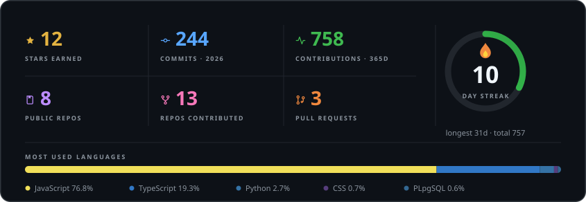
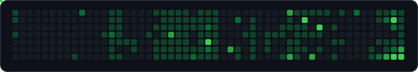

<table>
<tr>
<td width="55%" valign="middle">

<h1>Hello, I'm Ayush Singh.</h1>

<h3>DSA • Backend Developer • Open to Remote Opportunities </h3>

</td>

<td width="45%" align="center">

</td>
</tr>
</table>
 

<!-- 

  

 -->

 <!-- <pre>
readme_status = {
    "status": "in progress...",
    "focus": ["structure", "clarity", "project highlights"],
    "last_update": "ongoing"
}
print("README optimization underway")
  </pre>-->

<!--  -->

---

## About Me 👋

Third-year Computer Engineering student in Mumbai, focused on backend engineering: APIs and the databases behind them. I build mostly with Node.js, Express and FastAPI, using PostgreSQL, MongoDB and Supabase. I'm strengthening my DSA and system design fundamentals.

Other projects include IntelliX (academic management) and NivaaranAI (civic grievances). Open to internships and remote backend work.

---

  &nbsp;
  &nbsp;
  

---

## ⭐ Projects
| Project | Description | Tech Stack | Live Demo |
|----------|-------------|------------|-----------|
|  **IntelliX** | Smart academic management system for student records, attendance, batch management, analytics, and role-based access. Designed with scalable REST APIs and modular backend architecture. | Node.js, Express, MongoDB | **[View Project](https://intelli-x.vercel.app/)** |
|  **Evalix AI** | AI-powered evaluation platform for managing tests, submissions, automated assessments, and performance analytics with a scalable educator-focused workflow. | Node.js, Express, MongoDB, AI APIs *(Planned)* | **[View Project](https://evalix-ai.vercel.app/)** |
|  **NivaaranAI** | AI-powered civic intelligence platform featuring complaint classification, duplicate detection, sentiment analysis, priority scoring, ward-level routing, and analytics dashboards. | Next.js, TypeScript, Tailwind CSS, Supabase, FastAPI, TensorFlow, NLP | **[View Project](https://nivaaran-ai.vercel.app/)** |
|  **SpiderChat** | Real-time Spider-Verse themed chat platform with room-based messaging, media sharing, reactions, replies, typing indicators, and dark/light mode. | Next.js, React, TypeScript, Tailwind CSS, Node.js, Express, Socket.IO | **[View Project](https://spiderchat.vercel.app/)** |

---

### 🔧 Languages & Tools

  <b>Languages</b> 
   
  <b>Frontend</b> 
   
  <b>Backend</b> 
   
  <b>Data &amp; ORM</b> 
   
  <b>Tools</b> 
  

---

## GitHub Insights

  
   
  
   
  dashboard snapshot as of 31 Oct 2026 &#183; activity card is live, updates daily

---

### 🏆Github Trophies

  

 

---

## 🔗 Let's Connect 

   &nbsp;
   &nbsp;
   &nbsp;
   &nbsp;
  <!--   -->

---

## 💬 Quote
> you put in the work, you get the results. it's that simple.

---

## Contribution Snake

  
   
  real contribution data &#183; snapshot as of 31 Oct 2026

---

<!-- 

 -->

  

